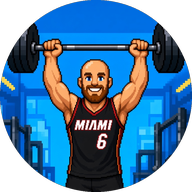

<p align="center">
  
</p>

<h1 align="center">GymTrack</h1>

<p align="center">
  A personal gym, body and running tracker for Android and Wear OS, built on <a href="https://github.com/DuarteSantos8/openGym">openGym</a>.
</p>

<p align="center">
  <a href="https://jaygit88.github.io/GymTrack/">Live demo</a> ·
  <a href="https://jaygit88.github.io/GymTrack/test/">Test demo</a> ·
  <a href="https://github.com/jaygit88/GymTrack/releases">Releases</a>
</p>

---

GymTrack is a personal fork of [openGym](https://github.com/DuarteSantos8/openGym), the
self-hosted gym tracker by Duarte Santos. It keeps everything openGym does (routines, a 5,600
exercise library with animations, progression, PRs, body weight, measurements, the watch app) and
reshapes it for one way of training: lifting for muscle size, running for cardio fitness, and
not planning sessions ahead. It runs on an Android phone with a Galaxy Watch, with no server
needed.

## What GymTrack adds

### Home, rebuilt around what you did
- **Last 7 days** instead of a planned week: every workout and run per day, today first, each
  with a small body map of the muscles it worked. A rest day can log a session you forgot.
  Several sessions on one day (a run in the morning, weights at night) are separate rows.
- **Short on time?** A quick workout for 15 to 60 minutes (see below).
- **Running card:** this week's distance against your goal and this week's planned runs, ticked
  off as you do them.
- **Body measurements map:** front and back of the body, each measured part green when it went
  the way you want (bigger arms, chest and legs, a smaller waist) and red when it did not, over
  1, 3 or 6 months, with the numbers underneath.
- **Measurement goals:** choose the parts you are working on. A card at the top flags any goal
  with no progress in a month, and can ask GymTrackAI why and what to change.
- **Your month:** a GymTrackAI review of the last 30 days with suggestions for the next.

### Quick workout
Say how long you have and get a session built from what your log says is most needed: every
muscle group, plus upper chest, side delts and rear delts, scored by how far its sets in the last
seven days fall short of its weekly target and how long since you trained it. Muscles trained
hard in the last two days are left to recover. It picks exercises you have done before (so your
weights are known), sizes the sets to the time, and starts it as a normal workout.

**Ask GymTrackAI** looks at the same picture in more detail (the last two weeks of sessions, finer
areas such as lower chest, the heads of the biceps and triceps, lats against mid-back, calves and
obliques) and chooses from a list of exercises your gym can do. Its answer is checked before you
see it.

### Running, from your watch
- **Health Connect:** runs that Samsung Health (or any app) saves come in with their heart rate,
  speed, laps, steps, climb and calories, plus VO2 max and resting heart rate.
- **Each run:** distance, time, pace, splits per km or mile, heart-rate zones, cadence, climb,
  energy, **metres per heartbeat** (how far you get for each beat, the clearest sign of cardio
  fitness) and whether your heart rate drifted in the second half.
- **Running page:** charts for weekly distance, pace, metres per heartbeat, resting heart rate and
  VO2 max, every run, and a warning when a week jumps more than 30 % above your usual.
- **Goals:** cardio fitness at a weekly distance, or a race from 5K to the marathon with an
  optional target time and race day. Race goals get an estimate from your recent runs, and a
  month without progress is flagged.
- **GymTrackAI running plan:** four weeks of runs towards the goal, mostly easy, built up
  gradually, with hard runs kept off leg days. Shown as a weekly checklist that your runs tick
  off.

### GymTrackAI
The AI features above use openGym's AI Coach connection with your own API key, on the phone:
no server, the key in Android's secure storage, a question before anything is sent, and a daily
limit. Answers come from Claude (Anthropic). What is sent is a summary (workouts with each
exercise's best set, runs, body weight, measurement changes and goals), never notes, photos or
your name. Each request is a small charge on your own Anthropic account.

### The app itself
- Its own Android app ID (`com.jaygit88.gymtrack`), name and icon, so it installs next to the
  official openGym app, and a matching Wear OS app.
- The in-app update check follows GymTrack's own releases.

## Live and test

| | Live | Test |
|---|---|---|
| Branch | `main` | `test` |
| Website (sample data) | https://jaygit88.github.io/GymTrack/ | https://jaygit88.github.io/GymTrack/test/ |
| Android app | **GymTrack**, from the **Release** workflow | **GymTrack Test**, rebuilt on every push to `test` |
| Download | the [latest release](https://github.com/jaygit88/GymTrack/releases/latest) | the **Test build** pre-release |

Changes go to `test` first. The test app installs next to the live one with its own data, so
trying something never touches your real log. When it is good, `test` is merged into `main`,
which updates the live website; tagging a version releases the live app.

## Getting it onto your phone

**1. Signing key (once).** Both apps are signed in GitHub Actions with your own key. Make one with
Java's `keytool`:

```bash
keytool -genkeypair -v -keystore gymtrack.keystore -alias gymtrack -keyalg RSA -keysize 4096 -validity 10000
```

Keep the file and its password safe: without them no update installs over the app. Then add three
repository secrets (Settings, Secrets and variables, Actions):

| Secret | Value |
|---|---|
| `ANDROID_KEYSTORE_BASE64` | `base64 -w0 gymtrack.keystore` (on a Mac: `base64 -i gymtrack.keystore`) |
| `ANDROID_KEYSTORE_PASSWORD` | the keystore password |
| `ANDROID_KEY_ALIAS` | `gymtrack` |

**2. Build.** Actions, **Release**, Run workflow with a version (for example `1.4.4`), or push a tag:

```bash
git tag v1.4.4 && git push origin v1.4.4
```

The version comes from the tag; each release needs a higher one than the last. The test app
builds by itself on every push to `test`.

**3. Phone.** Download `GymTrack-<version>.apk` from the release on the phone and install it.
Later releases are offered by the app itself.

**4. Watch.** Wear OS cannot install a downloaded file, so the watch app goes on with `adb`
(Android SDK Platform-Tools). Turn on Developer options, Wireless debugging on the watch, then:

```bash
adb pair <watch-ip>:<pairing-port>
```

```bash
adb connect <watch-ip>:<port>
```

```bash
adb install GymTrack-Wear-<version>.apk
```

Phone and watch apps must both come from GymTrack releases (one key) to pair.

**5. Bring your openGym history.** In openGym: Settings, Data & backup, Export backup. In
GymTrack: Settings, Data & backup, Import backup.

**6. Switch things on.**
- **Runs:** Settings, Health Connect, **Runs from your watch**, and allow what it asks. In Samsung
  Health, allow it to share exercise data with Health Connect.
- **GymTrackAI:** tap **Set up the AI Coach** on any GymTrackAI card, choose **Bring my own API
  key**, pick **Anthropic** and paste a key from console.anthropic.com.

## Developing

```bash
cd frontend && npm ci
```

```bash
cd frontend && npm test
```

```bash
cd frontend && VITE_DEMO=1 npx vite
```

The last one runs the browser demo with sample data. The checks CI runs, the project layout and
the architecture are in [CLAUDE.md](CLAUDE.md) and [docs/ARCHITECTURE.md](docs/ARCHITECTURE.md);
openGym's guides are in [docs/](docs/README.md). New text shown in the app goes into every
language pack in `frontend/src/locales/` (CI checks it).

GitHub Actions:

| Workflow | Does |
|---|---|
| `test.yml` | Every push to `main` and `test`: the web, API, MCP and Android checks |
| `pages.yml` | Publishes both demos to GitHub Pages |
| `release.yml` | A `v*` tag: signed live phone and watch APKs as a GitHub release |
| `test-app.yml` | A push to `test`: the signed test apps on the **Test build** pre-release |

Where the GymTrack parts live:

| Feature | Code |
|---|---|
| Home | `frontend/src/views/Home.jsx`, `components/RecentDays.jsx` |
| Body measurements map and goals | `lib/measure-change.js`, `components/MeasureChangeCard.jsx` |
| Quick workout | `lib/quick-workout.js`, `components/QuickWorkout.jsx` |
| Running | `lib/runs.js`, `lib/running.js`, `views/Running.jsx`, `components/RunSheets.jsx`, `components/RunningCard.jsx` |
| Health Connect reading | `lib/health-sync.js`, `android/.../HealthConnectPlugin.java`, `HealthRead.java` |
| GymTrackAI | `lib/ai-review.js` (what is sent and how answers are checked), `lib/ai-review-run.js`, `components/AiReviewCard.jsx` |

### Keeping up with openGym

openGym is the `upstream` remote. To bring in its updates:

```bash
git fetch upstream && git checkout test && git merge upstream/main
```

Expect conflicts where GymTrack changed the same files, most often `views/Home.jsx`, the locale
packs and the workflows GymTrack removed (`git rm` those to keep them removed).

## Credits and licence

GymTrack is a modified version of **[openGym](https://github.com/DuarteSantos8/openGym)**,
Copyright (C) 2026 Duarte Santos, and like openGym it is licensed under the
[GNU AGPL v3.0](LICENSE). The source of this version is this repository.

> [!IMPORTANT]
> **The exercise stills and animations are not covered by the AGPL.** They are © Aliaksandr
> Makatserchyk, [Gym visual](https://gymvisual.com/), licensed for use in openGym. A
> non-commercial fork such as this one may keep them unmodified with their notice; any other use
> needs a licence from gymvisual.com. Details and every other third-party notice (body-map
> geometry, exercise text, QR libraries) are in [NOTICE.md](NOTICE.md).

The openGym [Contributor License Agreement](CLA.md) applies only to changes sent back to openGym
itself.
